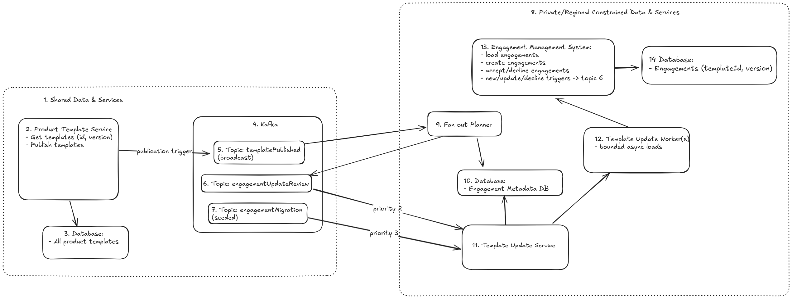

## Introduction

Let's use an event-driven, regional projection model.
A template publish happens once on the shared side, is broadcast to every region, and is then planned locally. Each region uses its own metadata store to find candidate engagements, enqueues engagement-level review work, and processes that work through a bounded worker that calls Engagement Management only when needed.
That keeps the expensive one-minute engagement load off the publish path, preserves regional residency, and gives the product a fast read model for the pending-update indicator.

## Diagram walkthrough

The numbered boxes tell the story:

- **1-4** are the shared side: shared data/services, the Product Template Service, the shared template database, and Kafka.
- **5-7** are the Kafka streams: `5` is `templatePublished` (broadcast), `6` is `engagementUpdateReview`, and `7` is `engagementMigration` (seeded).
- **8-14** are the regional side: `8` is the regional boundary, `9` is the fan-out planner, `10` is the Engagement Metadata DB, `11` is the Template Update Service, `12` is the bounded worker, `13` is Engagement Management and `14` is the engagements' database.

Important to notice is that events do not go straight to the slow worker. The `templatePublished` event first flows into the fan-out planner, which emits `engagementUpdateReview` work. Both review stream and the seeded migration stream feed the bounded worker.
## 1) Architecture and data ownership

**Shared template side**

- Product Template Service owns template versions and publish events.
- The template database remains the source of truth for template content.
- A publish produces a durable `templatePublished` event that is broadcast to every region.

**Regional engagement side**

- Engagement Management owns engagement state, creation, and accept/decline decisions.
- Engagement content stays in the regional engagement database.
- Engagement Metadata Database is the regional read model. It stores the current frontier for each engagement and feeds the pending-update indicator shown to users.

**Fan-out planner**

- Consumes the regional copy of `templatePublished`.
- Queries the regional metadata database to find candidate engagements for that template.
- Enqueues engagement-level review work onto `engagementUpdateReview`.

**Template Update Service**

- owns the regional pending-update pipeline. It coordinates concurrency and manages priority of update review over migration.

**Worker**

- Consumes both `engagementUpdateReview` and `engagementMigration`.
- Performs bounded asynchronous engagement loads through Engagement Management.

**Engagement lifecycle updates**

- Engagement create, update, accept, and decline actions remain owned by Engagement Management.
- Those actions also trigger the same regional review flow `engagementUpdateReview` so the metadata projection stays current.

**Migration**

- `engagementMigration` is a separate seeded backfill stream, populated initially with the region's known engagements.
- It exists to fill missing metadata, not to serve as the steady-state path for publish processing.

This keeps ownership clear: templates are shared, engagements stay with Engagement Management, and the only new query surface is the regional metadata projection.

## 2) Correctness and production evolution

Template versions do not form a simple line, so I would model them as an immutable graph with explicit ancestry.

That makes the semantics of decline clearer:

- a decline pins the engagement at its current frontier, not forever to one version
- if a later publish is a descendant that contains earlier changes, it is still a new offer
- withdrawn versions are not surfaced as fresh updates, but their history remains auditable

For delivery correctness, I would use:

- durable publish events
- engagement-level review work with stable idempotency keys
- at-least-once delivery guarantee
- Immutable projections so older worker results cannot overwrite newer state

The key race to handle is stale in-flight work. A worker may load engagement metadata based on older state while a user has already created or updated that engagement. I would not try to prevent all stale work from running. Instead, I would require the metadata write to be monotonic: if a newer frontier is already stored, the older worker result becomes a no-op.

## 3) Scale, cost, and operational characteristics

The expensive part is loading engagements, so the design pushes as much work as possible to metadata lookups rather than full blind engagement loads.

Useful scale anchors:

- 40 products
- about 1 publish per week per product, or roughly 160 publishes per month
- 800,000 active engagements across 4,000 firms, with heavy skew

If a publish affects about 1/40 of the estate on average, that is on the order of 20,000 candidate engagements per publish. Broadcasting one small publish event to each region is cheap. The heavy work remains regional and bounded.

Cost control comes from:

- keeping metadata regional and queryable
- reserving headroom for user traffic
- capping background concurrency
- treating migration as a throttled backfill that yields first under pressure

To stay under $X/month, I would combine bounded concurrency with a monthly budget envelope. The system would track the volume of engagement loads per month, use AWS budget alarms for visibility, and throttle or defer lower-priority work when the remaining budget is low. Migration would be the first work class to slow down.

Operationally, I would watch:

- publish to visible latency
- backlog and oldest message age by region
- planner fan-out size
- worker admission/rejection rate
- DLQ depth
- migration completion by region

Kafka remains the durable backlog. The worker should not introduce a second durable queue or an internal scheduler.

## 4) Human-readable summaries

Summaries should be generated once per template publish in the shared system, then reused for every affected engagement.

I would base the summary on the structured diff and render it with deterministic, template-guided sections such as:

- added
- removed
- changed
- moved

That gives us a human-readable result without generating a custom summary per engagement.

I would store a summary artifact with:

- template id
- previous and offered versions
- publication id
- diff hash
- summary text
- summary template version
- generation timestamp

That makes the summary defensible months later in a regulatory review. A summary shown in March should still be reproducible in November.

The key point is that the same diff input always produces the same text. An LLM can be used later to improve wording, but the shared summary should stay deterministic so it is cheap, stable, and auditable.

## 5) Tradeoffs, assumptions, and the requirement I would challenge

**Tradeoffs**

- **Planner plus Template Update Service split:** a little more moving parts, but it matches the fan-out problem better than treating publish events as direct engagement work
- **Template Publish broadcast:** duplicates the publish signal per region, but keeps engagement scans and metadata local
- **Conditional projection writes:** simpler than introducing reconciliation into this exercise, while still protecting correctness against stale worker output
- **Bounded concurrency:** protects Engagement Management first and lets Kafka absorb backlog

**Assumptions**

- each engagement belongs to exactly one region
- each region has its own Engagement Management boundary
- publish events can be broadcast to all regions
- delayed retry behavior such as exponential backoff and jitter is provided by Kafka retry-topic wiring or platform infrastructure, not by a custom scheduler inside this component (to keep this exercise simple enough)

**Requirement I would challenge**

I would challenge the strict “within seconds” real-time expectation. Given the one-minute engagement load constraint and the lack of a maintenance window, an estate-wide recomputation cannot be truly synchronous without either overloading Engagement Management or requiring an impractically large parallel fleet. A more realistic target is progressive freshness: the publish becomes visible quickly, and the full estate catches up through bounded regional fan-out and backfill.

**Future exploring**

A possible extension would be a richer extracted engagement projection alongside the source system. Instead of reloading the full engagement for every comparison, we could maintain a smaller regional snapshot of the fields needed for template comparison and pending-update state. That would make later template evaluations faster without changing the source of truth.
## Riskiest part

The riskiest part is keeping the regional projection current while relying on slow, capacity-constrained downstream systems. If the initial migration/backfill cannot complete fast enough, or if the owned system cannot support ongoing hooks and updates at the needed pace, the backlog can become effectively never-ending.
## Deliberately left out

- applying the updated template content
- a full reconciliation/rebuild pipeline
- UI design beyond the pending-update indicator and summary payload
- LLM inference in the hot path
